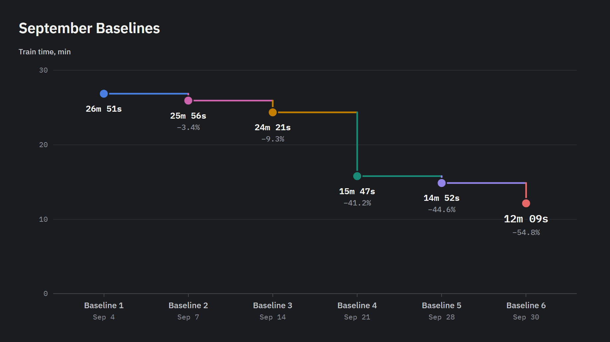
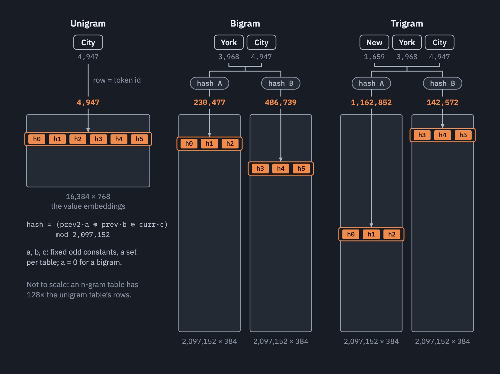
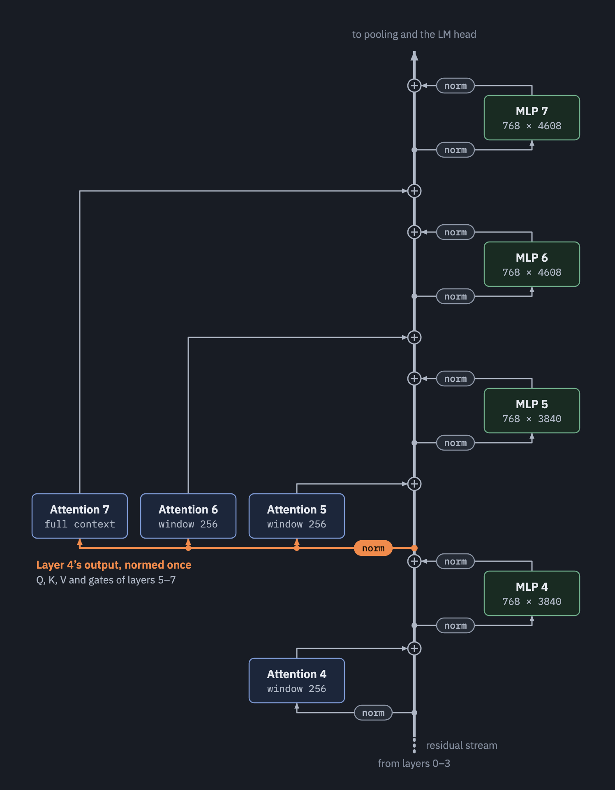
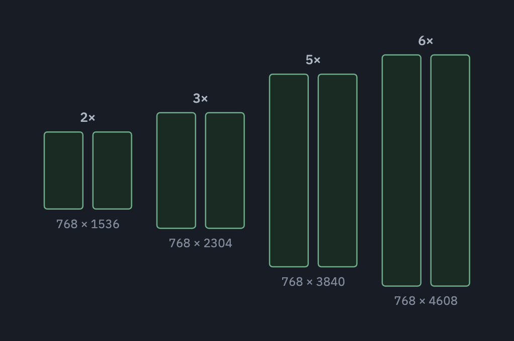

# Backward Pass Speedrun

Over the course of September 2026, I worked with Claude to see how fast we could train a 768-dim nanochat model on a single GPU, writing the code as a single `forward_backward` function, with no autograd. 

- The goal here is to reach 0.900 val bpb on an RTX Pro 6000 (A Blackwell GPU with 96GB of memory) as quickly as possible. 
- Everything is flat pytorch, with no autograd, nn.Module, or nn.optim.
- I also decided not to allow / pursue FP8 or custom triton kernels.

We got the time down from 26m 51s to 12m 09s:



> The baseline runs are all on wandb, [here](https://wandb.ai/chrismccormick/decoderstack_rtx), with more details in their PRs below.

Ironically, what started out as iterative improvements eventually gave way to being essentially a port of rekursiv.ai's ([(auto)²-research](https://rekursiv.ai/blog/autoautoresearch/)) winning run, labeled `exp022`. 

> Announced on [X](https://x.com/hyperparticle/status/2099861544481731058) on September 15th, a swarm of AI agents ran for three days on rekursiv's research harness and beat the state of the art on Karpathy's auto-research benchmark.

Matching their architecture, the final `decoder-rtx` has model dim 768, a 16K vocab, and 8 layers with 54M active parameters (the projection matrices) and another 10.6B in embedding tables. (M = 2^20, B = 2^30)

In the end, you could summarize our most notable contributions (over rekursiv's result) as:

1. Consolidating their recipe into a single script, with flat code and a handwritten backward pass.

2. Making it fit on a 96GB card (they ran on 141GB H200s, and quote their final number on a 192GB B200) by inlining the optimizer math on the embedding tables into the backward pass to avoid storing the gradients.

Details on their architecture, our contributions, and project takeaways are below.

#### Contents:

1. Baselines
2. Architecture
3. Our Contributions
4. Lessons and Takeaways
5. Acknowledgments
6. How to Run

---

## 1 - Baselines

| Name | Time | Δ from Baseline 1 | Slack (µbpb) | Write-up |
| --- | --- | --- | --- | --- |
| 2026-09-04 - Baseline 1 | 26m 51s | - | 271 | [#1](https://github.com/chrisjmccormick/stacks/pull/1) |
| 2026-09-07 - Baseline 2 | 25m 56s | -0m 55s | 837 | [#3](https://github.com/chrisjmccormick/stacks/pull/3) |
| 2026-09-14 - Baseline 3 | 24m 21s | -2m 30s | 837 | [#4](https://github.com/chrisjmccormick/stacks/pull/4) |
| 2026-09-21 - Baseline 4 | 15m 47s | -11m 04s | 920 | [#5](https://github.com/chrisjmccormick/stacks/pull/5) |
| 2026-09-28 - Baseline 5 | 14m 52s | -11m 59s | 1,531 | [#6](https://github.com/chrisjmccormick/stacks/pull/6) |
| 2026-09-30 - Baseline 6 | 12m 09s | -14m 43s | 476 | [#7](https://github.com/chrisjmccormick/stacks/pull/7) |

Each baseline's PR has the write-up of what it changed. The baseline runs can all be viewed on wandb, [here](https://wandb.ai/chrismccormick/decoderstack_rtx).

---

## 2 - Architecture

Here are some of the core architecture features that I found most interesting. 

### 2.1. n-gram Tables

The architecture makes heavy use of giant n-gram tables that contribute to every other layer. I wanted to understand these better, so I've essentially written a tutorial here.

A bigram is a pair of tokens, like ('New', 'York'). New York's trigram distribution predicts what token will come next just based on the number of times it follows New York in the dataset.

Without attention or gating, the gradient signal that reaches these table entries would literally teach them to adjust the model towards producing the (n+1)-gram distribution for its entries.

For example, a model's input embeddings could be called a unigram table, and if they were connected directly to the LM head, they would learn the dataset's bigram distributions (though at a reduced rank). 

_However_, these tables also learn more complex information because:
1. Their entries are gated on signal from the residual stream
2. Later tokens will contribute gradient to them via attention

A later token which attends to 'City' in ('New', 'York', 'City') will receive the trigram table entry for New York City, which could capture its identity, for example.

#### Hashed n-gram Tables

n-gram distributions grow exponentially larger. If you wanted to create a table with one entry for every combination, for a 16K vocab it would require:

- bigram: `16K x 16K = 256M` rows (one per ordered pair)
- trigram: `16K x 16K x 16K = 4T` rows (one per ordered triplet)

As a compromise, we use a smaller table and hash the token ids to compute an index into the smaller table. The bigram and trigram tables in this model have 2M rows, which is 128x the size of the vocab but also 128x smaller than the number of bigrams. 

This results in collisions, and a given table entry will learn a mix of all of its colliding entries. 

Both a bigram and trigram table are added to roughly every other layer, starting from the second:
- 'bigram' tables are on layers 1, 3, 5, 7
- 'trigram' tables are on layers 1, 5, 7 
- For reference: value embeddings are also on layers 1, 3, 5, 7

#### As Value Embeddings

The first bigram table to appear in a speedrun was the bigram hash table added by Larry Dial to modded-nanogpt [PR #201](https://github.com/KellerJordan/modded-nanogpt/pull/201). It was a single table sized at 5x the vocab, and it was shared by every layer--the retrieved rows were added directly to the residual stream at the start of each layer. (decoder-rtx had this up through baseline 5 as well).

Interestingly, `exp022` adds them instead to the values in the same way that Value Embeddings are added, adding them to the value vectors and using a per-head gate.

Since all three tables are different types of value embeddings, you could think of the standard value embeddings (first conceived by Braden Koszarsky (@KoszarskyB)) as being full-size "unigram" tables, which learn bigram distributions among other things.  

#### Three Heads Per Table

Because these n-gram tables are storing per-head value embeddings, they are essentially 6 tables (one per attention head) concatenated together. 

We could use a unique hash index for each head so that a collision doesn't impact every head at once. However, this requires 6x the number of table look-ups (embedding "gathers").  

`exp022` goes partway there and divides them into two tables of three heads each. That means we compute two hashes per input token, and do two separate lookups.



#### Per-Head Gates

On a layer which has all three tables (bigram, trigram, and value), there are three 128-dim embeddings being added to a given 128-dim value vector. Each of these is mixed with a small gate applied, and each table has its own set of gates (18 independent gates altogether, per layer!).

The inputs to these gates are 16-dim slices of the residual stream:
- 'Unigram' uses dims 0–15,
- Bigram uses 16–31, 
- Trigram uses 32–47

These gates are part of what makes the function of these tables more subtle than just learning n-gram distributions.

### 2.2. Context vs. Prediction Layers

This is the feature I find the most fascinating, and it concerns how attention works in the final three layers.

Attention blocks 5, 6, and 7 still write to the input of their respective MLPs, but they all _read_ from the output of layer 4. 



You can run attention blocks 5, 6, and 7 all at once at the output of layer 4.

> Almost as if it were a single block with 18 heads, except you still need to separate the outputs into three groups of six.

This means that MLPs 5, 6, and 7 are exclusively involved in predicting the next token; they can't contribute anything to the context shared across tokens.

The final three layers are performing prediction, and any contextual information they are leveraging comes entirely from the first five layers.

> It seems to draw on the same principles as backout (which `exp022` does not include).

It also gives a significant performance improvement to the prefill part of text generation: For prefill tokens, you only need to run the first 5 of 8 MLPs and FlashAttention calls. 

Pretty cool!

### 2.3. Graduated MLP Width

The model has 8 layers and, instead of the standard "4x MLP expansion", it redistributes the parameters and uses smaller MLPs in the early layers and wider ones at the end.

The multipliers are 2x, 3x, 5x, and 6x, applied to two layers each. i.e.,

`2 - 2 - 3 - 3 - 5 - 5 - 6 - 6`



(Note that it still averages out to 4x, i.e., it has the same number of MLP parameters as an 8-layer model with a 4x factor).

This relates to the previous section in an interesting way as well. The model has a total MLP width of 32x, and it allocates 15x to the context layers and 17x to the prediction layers.

---

## 3 - Our Contributions

### 3.1. Selective Stashing / Recompute

Control over the backward pass allows us to strategically decide to re-compute certain forward activations during the backward pass, rather than allocating the memory to stash them.

This was crucial at various points during development. 

Notably, though, baseline 6 has ample memory headroom, and we might be able to reclaim a little speed by stashing everything.

### 3.2. Inlined Optimizer for Tables

The n-gram tables are 22.5GB, and bf16 gradient buffers would have required an additional 22.5GB, which would OOM on the RTX 6000's 96GB.

The tables are optimized using sparse RMSProp (only updates the rows actually used by the batch); we inlined this code into the backward pass to avoid allocating those gradient buffers.

### 3.3. Project Vocab Through Attention

Layer 0's queries, keys, and values are unique in that they don't depend on the context--a given token will always produce the same ones.

To take advantage of this, instead of projecting 192K tokens through layer 0's QKV, we project the 16K vocabulary embeddings.

Then, to form the input to the forward pass, we select each token's queries, keys and values, instead of its input embedding. 

Side Note: We also tried learning layer 0's queries, keys, and values directly. That was slightly faster, but was hurting loss. Didn't explore that idea much because projecting the vocab doesn't change the math and was almost as quick. 

> Note that this idea is incompatible with having a smear gate, which `exp022` didn't use anyway.

### 3.4. Optimizer Precision

`exp022` used bf16 weights for everything.

In `decoder-rtx`, we keep fp32 "master weights" for the projection matrices using You Jiacheng's (@YouJiacheng) mantissa-storing trick. 

We also made the input embeddings fp32, and kept all scalars as fp32.

### 3.5. Miscellaneous

- We used FlashAttention `varlen` in place of `exp022`'s batched attention, which avoids spending flops attending to (irrelevant) tokens in other documents. 

---

## 4 - Lessons and Takeaways

### 4.1. "Points of Slack"

Changes in validation loss can be difficult to talk about because they're often tiny fractions. 

For example, you might say that a particular change "improved loss by 0.0043 validation bpb" (a strong improvement). 

That's a difficult number to reason about, especially when Claude starts discussing multiple loss values in a conversation or write-up. 

I've found a different nomenclature very helpful: "points of slack".

_1 point = 1 µbpb_

First off, it helps just to increase the magnitude of those numbers so that they become integers. Instead of a change of `0.0043` bpb, we can call it 4,300 µbpb, or 4,300 points.

_Slack_

In a speedrun challenge with a target validation loss, you tend to talk about loss relative to that target, rather than in absolute terms.

In our case, everything is relative to the `0.900000` bpb target that we're trying to hit.

Instead of saying "the run finished at `0.899729` bpb" or "the run finished `0.000271` under" we can say it finished with "271 points of slack".

We can also compare two runs by talking about their difference in slack.

_Slack --> Steps_

We often want to know: "we improved validation loss by this much--how many training steps can we remove?" 

Using a fixed seed, you can run an experiment to measure roughly how many points of slack one training step is worth. And that lets you:

1. Estimate a "cash-in" value for any loss improvements you make
2. Weigh trade-offs in loss vs. speed

You could already do all of that, it's just easier when you turn the loss into integers.

### 4.2. Handwriting Backward 


#### Difficulty

Simply put, this does not appear to be a big challenge for Claude. 

You might expect that it would involve many mistakes and time spent chasing elusive bugs, but it didn't. 

I assume that I will get more comfortable with the code over time as well--my sense is that it's not necessarily harder to understand, I just haven't familiarized myself with it enough yet. 

#### Variable Naming

More than the math or torch operations, _this_ is what makes the code difficult.

There are a large number of quantities computed in the forward pass which need to be "stashed" and then used again in the backward pass. And they all need names.

In equations, we have a lot more options for this. We can add a hat symbol over a variable name to indicate that it's been normed. We can add compact subscripts and superscripts. 

I managed to establish a few conventions that I like, e.g.:
- `x` is the forward residual stream, `xb` is the backward stream.
- `*_hat` means the quantity after rms norm has been applied.

In general, I'll have to keep refining the scheme across more projects. 

### 4.3. Agent Code

Something I really value about single file experiments is that it means you can cheaply replicate the entire thing, and have many throw-away copies lying around, and they're easy to diff to see what was done to them.

I'm also finding it helpful with agents. I have them work in copies of the training script inside a separate "agent-ops" repo, with timestamped folders for different work sessions. 

This gives the agent freedom to modify the code however it needs for its experiments, and then it becomes a separate step where any changes that we want to "promote" to `stacks` have to then be _ported over_. During that porting process is where I can impose firmer requirements for it to follow, so that the copy I actually review is much cleaner. 

---

## 5 - Acknowledgments

- `modded-nanogpt` and Larry Dial in particular, who is a saint for running that competition.
  - All of the architecture features in the initial baseline here came from that project.
- Andrej Karpathy for his beautifully clean repos, and for nanochat here in particular. 
  - The baseline model architecture and hyperparameters come from 12-layer nanochat ("d12"), and the overall pipeline is just a refactoring.

### 5.1. First Contributed By

Doing my best here to identify and credit the original speedrun contributors for any of the core ideas present in this `decoder-rtx` code.

- Value embeddings: Braden Koszarsky (@KoszarskyB), modded-nanogpt [2024-12-04 record](https://github.com/KellerJordan/modded-nanogpt/tree/master/records/track_1_short/2024-12-04_ValueEmbed), [tweet](https://x.com/KoszarskyB/status/1864746625572257852). 
   - Notably, Braden appears to be the original author of this technique. He cites residual connections on the values as inspiration, but the embeddings serve a different role.
- x0 connections: Keller Jordan (@KellerJordan), modded-nanogpt [2024-11-06 record](https://github.com/KellerJordan/modded-nanogpt/tree/master/records/track_1_short/2024-11-06_ShortcutsTweaks), [tweet](https://x.com/kellerjordan0/status/1854296101303800108).
- ReLU²: @Grad62304977 and @SKYLINEZ007, modded-nanogpt [2024-10-14 record](https://github.com/KellerJordan/modded-nanogpt/tree/master/records/track_1_short/2024-10-14_ModernArch) ([tweet](https://x.com/kellerjordan0/status/1845865698532450646)). Paper: So et al., [Primer](https://arxiv.org/abs/2109.08668). 
- NorMuon: Zichong Li (@li_zichong), modded-nanogpt [2025-10-24 record](https://github.com/KellerJordan/modded-nanogpt/tree/master/records/track_1_short/2025-10-24_NorMuon), [PR #144](https://github.com/KellerJordan/modded-nanogpt/pull/144). Paper: Li et al., [NorMuon: Making Muon more efficient and scalable](https://arxiv.org/abs/2510.05491).
- Cautious Weight Decay: Varun Srivastava (@varunneal), modded-nanogpt [2025-11-10 record](https://github.com/KellerJordan/modded-nanogpt/tree/master/records/track_1_short/2025-11-10_CautiousWD), [PR #154](https://github.com/KellerJordan/modded-nanogpt/pull/154). Paper: Chen et al., [Cautious Weight Decay](https://arxiv.org/abs/2510.12402). 
- Softcapped logits: @Grad62304977, modded-nanogpt [2024-11-06 record](https://github.com/KellerJordan/modded-nanogpt/tree/master/records/track_1_short/2024-11-06_ShortcutsTweaks), [tweet](https://x.com/kellerjordan0/status/1854296101303800108). Paper: Gemma Team, [Gemma 2](https://arxiv.org/abs/2408.00118). 
- Mantissa storage: You Jiacheng (@YouJiacheng), modded-nanogpt medium [2025-04-16 record](https://github.com/KellerJordan/modded-nanogpt/tree/master/records/track_2_medium/2025-04-16_Record7), [tweet](https://x.com/YouJiacheng/status/1912570883878842527). 
- Bigram hash: Larry Dial (@classiclarryd), modded-nanogpt [2026-01-19 record](https://github.com/KellerJordan/modded-nanogpt/tree/master/records/track_1_short/2026-01-19_BigramHashEmbedding), [PR #201](https://github.com/KellerJordan/modded-nanogpt/pull/201), [tweet](https://x.com/classiclarryd/status/2013520088297558274).

Some of my own contributions are in `decoder-rtx` as well:
- Fused NorMuon: modded-nanogpt [2025-12-11 record](https://github.com/KellerJordan/modded-nanogpt/tree/master/records/track_1_short/2025-12-11_NorMuonOptimsAndFixes), [PR #168](https://github.com/KellerJordan/modded-nanogpt/pull/168), [tweet](https://x.com/classiclarryd/status/2000272495644152317).
- Fused AdamW: modded-nanogpt [2025-12-31 record](https://github.com/KellerJordan/modded-nanogpt/tree/master/records/track_1_short/2025-12-31_GatesToCompiledAdam), [PR #187](https://github.com/KellerJordan/modded-nanogpt/pull/187), [tweet](https://x.com/classiclarryd/status/2007882371576873445).
- Parameter banks: modded-nanogpt [2026-01-18 record](https://github.com/KellerJordan/modded-nanogpt/tree/master/records/track_1_short/2026-01-18_UnifiedOptimizers), [PR #200](https://github.com/KellerJordan/modded-nanogpt/pull/200), [tweet](https://x.com/classiclarryd/status/2013399457841160702).


### 5.2. Comparison to Other Speedruns

**[modded-nanogpt](https://github.com/KellerJordan/modded-nanogpt)**

- Time to 3.28 val loss on FineWeb
- 8x H100
- Custom triton and FP8

**[nanochat](https://github.com/karpathy/nanochat)**

- Fastest time to target val bpb on ClimbMix
- 8x H100
- Yes FP8, no custom triton, ~simple and scalable techniques only

**[auto-research](https://github.com/karpathy/auto-research)**

- Minimize val bpb on ClimbMix within a time budget
- Single GPU
- The focus / intent is autonomous research, seeing what AI agents can accomplish on their own.

**[Parameter Golf](https://github.com/openai/parameter-golf)**

- Minimize val bpb on FineWeb within 10 minutes
- 8x H100
- Compressed weights (and code) must fit in 16MB

---

## 6 - How to Run

Run it from within this folder as `python ./train_stack.py`.

If you'd like help with setup: Point your coding agent at `agent-setup-env.md` (or go through those steps yourself) to set up a fresh GPU instance. 

It references an '~/env.sh' file--I keep one of those locally 
(not committed to any repos!) to make it easy to set up my environment
variables like GitHub and wandb credentials on a fresh instance.

Then run:

```bash
micromamba activate stacks
cd ~/stacks/stacks/decoder-rtx/
python train_stack.py
```
